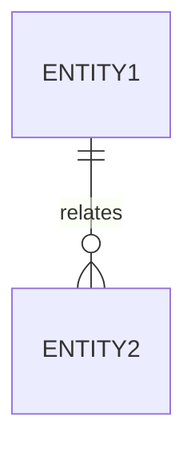

# [Назва модуля / Компонента]: Специфікація вимог

## 1. Мета та контекст

- **Контекст:** [Короткий опис bounded context та його ролі в системі]
- **Мета:** [Яку бізнес-проблему вирішує модуль]
- **Відповідальність:** [Що модуль робить, а що категорично НЕ робить]

---

## 2. API Контракти (Transport Layer)

Усі маршрути реєструються з обов'язковим префіксом `/api/v1/[module-prefix]`.

### 2.1. Ендпоінт: `[METHOD] /api/v1/...`

- **Опис:** [Призначення маршруту]
- **Автентифікація:** [None | Bearer JWT | HWID Handshake]
- **Request Body / Query Params (Fastify / Zod Schema):**

```json
{
  "field": "type"
}
```

- **Responses:**
  - `200 OK`: `...`
  - `400 Bad Request`: `...`
  - `401 Unauthorized / 403 Forbidden`: `...`
  - `404 Not Found`: `...`

---

## 3. Модель даних (Domain & Persistence)

- **Сутності:** [Перелік доменних сутностей]
- **ER / Зв'язки:**



---

## 4. Ключові сценарії виконання (Scenarios)

1. **Основний успішний сценарій (Happy Path):**
   - Крок 1 $\rightarrow$ Крок 2 $\rightarrow$ Крок 3.
2. **Сценарії помилок (Edge Cases / Failure Modes):**
   - Умова 1 $\rightarrow$ Очікуваний HTTP статус та код доменної помилки.

---

## 5. Критерії прийнятності (Acceptance Criteria & DoD)

- [ ] Типізація сувора (відсутність `any`, строгі інтерфейси DTO та сутностей).
- [ ] Валідація вхідних даних на рівні схеми транспорту.
- [ ] Бізнес-логіка інкапсульована у Service, доступ до даних — через Repository.
- [ ] Unit/Integration тести покривають основний сценарій та крайові випадки.
- [ ] pre-commit та pre-push хуки проходять без помилок.

---

## 6. Відомі компроміси та «зрізані кути» (Trade-offs)

- [Опис тимчасових спрощень чи технічного боргу із посиланням на задачі/коміти]
