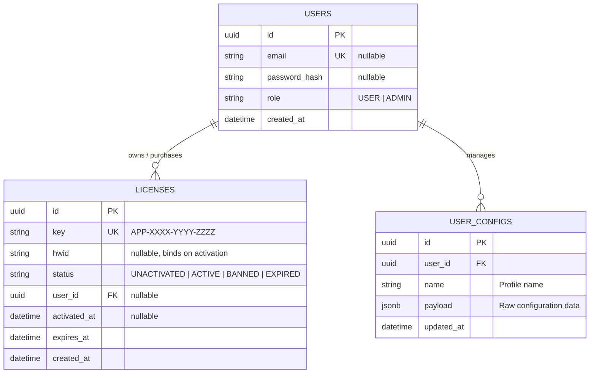

# Архітектурна специфікація: License & Config Hub

## 1. Призначення системи

**License & Config Hub** — модульний бекенд-сервіс і високопродуктивний шлюз авторизації для десктопного ПЗ комп'ютерного зору (детекція об'єктів). Забезпечує вітрину та онлайн-продаж ліцензійних ключів, адміністрування ліцензій, зберігання JSON-конфігурацій користувачів та низьколатентну верифікацію ключів із прив'язкою до апаратного ідентифікатора (HWID).

---

## 2. Модульна декомпозиція (Bounded Contexts)

- **`auth`:** Реєстрація, автентифікація користувачів (JWT/сесії), розмежування прав доступу (RBAC: `USER`, `ADMIN`).
- **`licenses`:** Вітрина тарифних планів, оформлення покупок та обробка оплати (платіжні вебхуки/checkout), адміністративне керування ліцензіями: генерація ключів (формат `APP-XXXX-YYYY-ZZZZ`), відстеження статусів (`UNACTIVATED`, `ACTIVE`, `BANNED`, `EXPIRED`), моніторинг активацій.
- **`configs`:** Зберігання та валідація JSON-профілів параметрів клієнта (чутливість моделі, роздільна здатність, алгоритми згладжування).
- **`loader`:** Критичний ізольований шлюз (`/api/v1/loader/handshake`) для верифікації клієнтського лоадера та атомарної прив'язки HWID.

---

## 3. Модель даних (ER-діаграма)

---

## 4. Ключові сценарії взаємодії

1. **Купівля та видача ліцензії:** Користувач обирає тариф на вебсайті та оформлює покупку. Після успішної оплати (платіжний вебхук) або через адмін-панель у базі створюється запис у `LICENSES` зі статусом `UNACTIVATED`, терміном дії, прив'язкою до `user_id` покупця та `hwid = null`.
2. **Первинний запуск лоадера (Атомарна прив'язка):**
   - Клієнт надсилає `POST /api/v1/loader/handshake` з `{ license_key, hwid }`.
   - Сервер перевіряє статус: якщо `UNACTIVATED` та `hwid === null`, в атомарній транзакції фіксується переданий HWID, статус змінюється на `ACTIVE`, виставляється `activated_at`. Відповідь: `200 OK (status: OK, action: BOUND)`.
3. **Повторний запуск лоадера (Авторизація):**
   - Якщо `incoming_hwid === license.hwid` та ліцензія активна $\rightarrow$ `200 OK (status: OK, action: AUTHENTICATED)`.
   - Якщо `incoming_hwid !== license.hwid` $\rightarrow$ `403 Forbidden (HWID_MISMATCH)`.
4. **Збереження та синхронізація конфігу:** Авторизований користувач передає свій JSON-профіль через `POST /api/v1/configs`, який зберігається у полі `payload` сутності `USER_CONFIGS`.

---

## 5. Аудит залежностей (Топ-3 свідомо відхилені бібліотеки)

1. **Express.js:** Відхилено на користь **Fastify** через нижчу пропускну здатність та відсутність вбудованої компіляції схем валідації (`fast-json-stringify` / `Ajv`).
2. **NestJS:** Відхилено через надлишковий оверхед рефлексії/декораторів та непрозорість стека викликів під час профілювання вузьких місць у Лабораторній 5.
3. **Bcrypt:** Відхилено на користь нативного модуля `node:crypto` (`scrypt`), щоб виключити залежність від компільованих C++ бінарників (node-gyp) у CI/CD середовищі.
