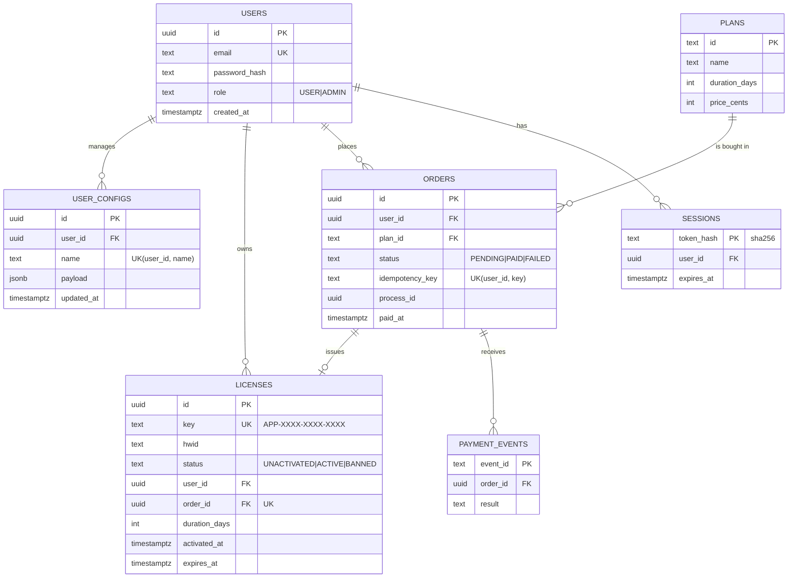

# Специфікація: License & Config Hub (Завдання 2 — дані та сценарії)

**Намір.** Бекенд для десктопного ПЗ комп'ютерного зору: продаж ліцензій, кабінет користувача з JSON-конфігами, адмінка ключів і швидкий шлюз handshake для лоадера з прив'язкою до HWID. Усі сценарії працюють через HTTP API спершу на статичних даних (in-memory), потім на PostgreSQL — **без змін у роутах і сервісах**.

## 1. Модулі та сценарії (API, префікс `/api/v1`)

| Модуль     | Сценарій                                                     | Ендпоінт                                                                                                                             | Доступ      |
| :--------- | :----------------------------------------------------------- | :----------------------------------------------------------------------------------------------------------------------------------- | :---------- |
| `auth`     | реєстрація / вхід / вихід / профіль                          | `POST auth/register`, `POST auth/login`, `POST auth/logout`, `GET auth/me`                                                           | — / USER    |
| `licenses` | вітрина тарифів                                              | `GET plans`                                                                                                                          | —           |
|            | замовлення (checkout), стан замовлення                       | `POST orders` (заголовок `Idempotency-Key`), `GET orders/:id`                                                                        | USER (свої) |
|            | вебхук оплати від провайдера                                 | `POST payments/webhook` (заголовок `X-Webhook-Secret`)                                                                               | провайдер   |
|            | мої ліцензії                                                 | `GET licenses`                                                                                                                       | USER        |
|            | адмінка: реєстр з email власника, видача, бан, скидання HWID | `GET admin/licenses?status&limit&offset`, `POST admin/licenses`, `POST admin/licenses/:id/ban`, `POST admin/licenses/:id/reset-hwid` | ADMIN       |
| `configs`  | CRUD JSON-профілів за назвою                                 | `GET configs`, `GET/PUT/DELETE configs/:name`                                                                                        | USER (свої) |
| `loader`   | handshake лоадера                                            | `POST loader/handshake` `{ license_key, hwid }`                                                                                      | —           |
| система    | версія, стан БД                                              | `GET /version`, `GET /health`                                                                                                        | —           |

**Купівля (один business process, 3 запити):** `POST orders` → замовлення `PENDING` + `processId` → провайдер шле `payments/webhook {eventId, orderId, result}` → в **одній транзакції**: подія записана, замовлення `PAID`, створено ліцензію `UNACTIVATED` (`hwid = null`, `expires_at = null`) → `GET orders/:id` повертає ключ.

**Handshake:** ключ `UNACTIVATED` → **один умовний `UPDATE … WHERE hwid IS NULL`** фіксує HWID, `ACTIVE`, `activated_at = now()`, `expires_at = now() + duration_days` → `BOUND`. Далі той самий HWID → `AUTHENTICATED`, інший → `HWID_MISMATCH`. Термін іде від активації, а не від покупки.

## 2. Схема БД (`migrations/`)

`EXPIRED` не зберігається — обчислюється (`expires_at <= now()`), щоб не потрібен був фоновий job.

## 3. Помилки (формат `{ error: { code, message }, requestId, processId }`)

| HTTP    | Код                                                                | Коли                                                                                                    |
| :------ | :----------------------------------------------------------------- | :------------------------------------------------------------------------------------------------------ |
| 400     | `VALIDATION_ERROR`, `BAD_REQUEST`                                  | тіло/параметри не пройшли Zod, немає `Idempotency-Key`; інша помилка формату запиту                     |
| 401     | `UNAUTHENTICATED`, `INVALID_CREDENTIALS`, `INVALID_WEBHOOK_SECRET` | немає/прострочена сесія; хибний пароль; хибний секрет                                                   |
| 403     | `FORBIDDEN`, `KEY_BANNED`, `KEY_EXPIRED`, `HWID_MISMATCH`          | чужий ресурс / не ADMIN; стан ліцензії                                                                  |
| 404     | `NOT_FOUND`, `KEY_NOT_FOUND`, `ROUTE_NOT_FOUND`                    | немає ресурсу, зокрема користувача, якому видається ліцензія (чуже замовлення теж 404 — не розкриваємо) |
| 409     | `EMAIL_TAKEN`, `IDEMPOTENCY_CONFLICT`, `ORDER_NOT_PAYABLE`         | дубль email; той самий ключ з іншим `planId`; вебхук на закрите замовлення                              |
| 413/415 | `PAYLOAD_TOO_LARGE`, `UNSUPPORTED_MEDIA_TYPE`                      | тіло більше ліміту (конфіг > 64 KiB); непідтримуваний `Content-Type`                                    |
| 503     | `DB_UNAVAILABLE`                                                   | БД недоступна під час запиту (+ `Retry-After`)                                                          |

Клієнт бачить **лише** коди з цієї таблиці (+ `INTERNAL` 500): внутрішні коди фреймворку чи Postgres назовні не виходять.

## 4. Критерії прийняття

1. Кожен сценарій §1 проходить через HTTP: `npm run smoke` (in-memory) і `npm run smoke:db` (Postgres) — **один і той самий** сценарій, зелений на обох.
2. Шари: роути — лише HTTP і Zod; сервіси — бізнес-правила й перевірка доступу; SQL і транзакції — лише в `*.repository.postgres.ts`.
3. Залежності створюються в `container.ts` і передаються одним об'єктом; `requestId`, `processId`, `userId` потрапляють у **кожен** рядок логу через `AsyncLocalStorage`, без параметрів функцій.
4. Один глобальний обробник помилок; у коді немає `try/catch` «на все тіло».
5. Повторний `POST orders` з тим самим `Idempotency-Key` повертає те саме замовлення; повторний вебхук з тим самим `eventId` не створює другої ліцензії.
6. Два одночасні handshake з різними HWID на новий ключ: рівно один `BOUND`, другий `HWID_MISMATCH`.
7. Старт без БД — процес падає одразу (`SELECT now()`) з зрозумілою помилкою; БД впала під час роботи — `503 DB_UNAVAILABLE`, після відновлення сервіс працює без перезапуску. Транзієнтні помилки (`40001`, `40P01`, обрив з'єднання) — до 3 ретраїв усієї транзакції; колізія згенерованого ключа (`23505`) — повтор генерації.
8. Списки з даними пов'язаних сутностей (адмін-реєстр з email власника) — фіксована кількість SQL-запитів незалежно від розміру сторінки (без N+1); перевіряється полем `dbQueries` у лозі запиту.
9. Локальна БД — `docker compose`, порт `55432`; схема лише через міграції.
10. In-memory репозиторії тримають **ті самі інваріанти**, що й схема БД (FK, UNIQUE): порушення посилання (напр. видача ліцензії неіснуючому `userId`) — доменна помилка `404` на обох джерелах, ніколи не `201` з «висячим» id і не `500`.

## 5. Поза обсягом (свідомо)

Реальний платіжний провайдер (замість нього — вебхук зі спільним секретом, без підпису HMAC); JWT і refresh-токени (непрозорі сесії в БД); rate limiting handshake; підтвердження email; кеш для `loader` (лаба 5); автоматичні тести (лаба 3); вебфронтенд і розгортання на VPS — окремий трек після лаби 3 (клієнт цього HTTP API).
